<a href="https://mikeyhope.vercel.app">
  <picture>
    <source media="(prefers-color-scheme: dark)" srcset="https://raw.githubusercontent.com/Tesfamichael12/Tesfamichael12/main/assets/cover-dark.svg">
    <source media="(prefers-color-scheme: light)" srcset="https://raw.githubusercontent.com/Tesfamichael12/Tesfamichael12/main/assets/cover-light.svg">
    
  </picture>
</a>

[Portfolio](https://mikeyhope.vercel.app) · [LinkedIn](https://www.linkedin.com/in/tesfamichael-tafere/) · [Email](mailto:tesfamichael132@gmail.com) · [Telegram](https://t.me/hopmic)

I'm a full-stack AI engineer in Addis Ababa, Ethiopia. I build AI products end to end: the interface people use, the services behind it, and the retrieval and agent systems underneath.

My recent AI work has mostly been RAG pipelines, voice assistants and multi-agent automation, built with Next.js, Go and Python. I work with local and international clients, and I also build training data and evaluations for frontier AI models.

## Selected work

<table>
<tr>
<td width="50%" valign="top">

**DineQ**

Turns photos of paper menus into structured digital menus, then helps diners choose through a voice assistant grounded in a Pinecone RAG pipeline.

`Next.js` `Go` `Pinecone` `OCR` `Voice AI`

[Case study](https://mikeyhope.vercel.app/project/dineq-ai-menu-intelligence-platform)

</td>
<td width="50%" valign="top">

**Ace Study**

Turns a student's own material into study kits, adaptive quizzes and a text-and-voice tutor, with answers retrieved from that material.

`Next.js` `RAG` `Hybrid search` `Reranking` `Voice AI`

[Live](https://ace-exam-study.vercel.app/) · [Case study](https://mikeyhope.vercel.app/project/ace-study-ai-exam-prep)

</td>
</tr>
<tr>
<td width="50%" valign="top">

**Autonomous Sales Engine**

Stateful agents research, validate and draft outreach for B2B leads. Cut manual processing time by 92% at 10,000+ leads a month.

`LangGraph` `n8n` `Go` `Milvus` `AWS`

[Case study](https://mikeyhope.vercel.app/project/autonomous-multi-agent-sales-engine)

</td>
<td width="50%" valign="top">

**SafeDriveGuardian**

Scores driver fatigue on the device with computer vision, and pairs it with ESP32 firmware for crash detection and location-tagged SOS alerts.

`Python` `OpenCV` `MediaPipe` `ESP32` `React`

[Live](https://safe-dirve-guardian.vercel.app/) · [Source](https://github.com/Tesfamichael12/Smart-Real-Time-Driver-State-Monitoring-and-Emergency-Detection-System) · [Case study](https://mikeyhope.vercel.app/project/safe-drive-guardian-driver-monitoring-system)

</td>
</tr>
<tr>
<td width="50%" valign="top">

**Sanqa Trading**

Production platform for a furniture and advertising company, with a real-time order engine, live staff chat and a headless CMS.

`Next.js` `Node.js` `Socket.IO` `PostgreSQL` `Docker`

[Live](https://www.sanqatradingplc.com) · [Case study](https://mikeyhope.vercel.app/project/sanqa-trading-furniture-advertising)

</td>
<td width="50%" valign="top">

**Rivu**

Local-first Android hydration companion. A shared React app talks to native Java services for reliable alarms, notifications and schedule recovery.

`React` `TypeScript` `Capacitor` `Java` `Android`

[Source](https://github.com/Tesfamichael12/Rivu) · [Case study](https://mikeyhope.vercel.app/project/rivu-local-first-hydration-companion)

</td>
</tr>
</table>

## Experience

| Role | What I did |
| :--- | :--- |
| **Freelance Full-Stack Engineer** Self-employed · Current | Production web and mobile software for local and international clients, plus training data and evaluations for frontier AI models. |
| **Head of Education** A2SV · 2026 | Led data structures and algorithms training for 60 students, and built a progress platform used by 150+ students across three universities. |
| **Software Engineering Intern** Kacha · 2025 to 2026 | Owned leave management in a distributed HRMIS/ERP running across multiple companies, and built its full-stack OKR module. |
| **Backend Mentor** GDG On Campus AASTU · 2025 to 2026 | Mentored 50+ students in Node.js, REST API design and production practices. |
| **Software Engineer Intern** Eskalate · 2025 | Led a backend intern team shipping a REST API and real-time feed for 1k+ concurrent users at sub-200ms sync. Adaptive fraud detection cut scripted abuse by 95%. |

BSc in Software Engineering, Addis Ababa Science and Technology University, 2025. CGPA 3.8/4.0, Presidential Award.

## Stack

<table>
<tr><td valign="top"><strong>AI</strong></td><td><code>RAG</code> <code>Embeddings</code> <code>Hybrid search</code> <code>Reranking</code> <code>LangGraph</code> <code>n8n</code> <code>Pinecone</code> <code>Milvus</code> <code>OCR</code> <code>Voice AI</code> <code>OpenCV</code> <code>MediaPipe</code></td></tr>
<tr><td valign="top"><strong>Languages</strong></td><td><code>Python</code> <code>TypeScript</code> <code>Go</code> <code>Rust</code> <code>Java</code> <code>C++</code></td></tr>
<tr><td valign="top"><strong>Frontend</strong></td><td><code>React</code> <code>Next.js</code> <code>Tailwind CSS</code></td></tr>
<tr><td valign="top"><strong>Backend</strong></td><td><code>Node.js</code> <code>Express</code> <code>FastAPI</code> <code>Django</code> <code>Prisma</code> <code>gRPC</code> <code>WebSockets</code></td></tr>
<tr><td valign="top"><strong>Data</strong></td><td><code>PostgreSQL</code> <code>Redis</code> <code>MongoDB</code> <code>MySQL</code> <code>Supabase</code> <code>Neon</code> <code>Firebase</code></td></tr>
<tr><td valign="top"><strong>Infrastructure</strong></td><td><code>Docker</code> <code>Kubernetes</code> <code>GitHub Actions</code> <code>Nginx</code> <code>AWS</code> <code>GCP</code> <code>Vercel</code> <code>Linux</code></td></tr>
<tr><td valign="top"><strong>Testing</strong></td><td><code>Jest</code> <code>Vitest</code> <code>Cypress</code> <code>Postman</code></td></tr>
</table>

## Track record

<table>
<tr>
<td width="25%" valign="top"><h3>8,800+</h3>GitHub contributions since 2023</td>
<td width="25%" valign="top"><h3>580+</h3><a href="https://leetcode.com/u/hopmic/">LeetCode</a> problems solved</td>
<td width="25%" valign="top"><h3>280+</h3><a href="https://codeforces.com/profile/Meek_12">Codeforces</a> problems solved</td>
<td width="25%" valign="top"><h3>40+</h3>Coding contests</td>
</tr>
</table>

 

Have a project in mind? Email me at [tesfamichael132@gmail.com](mailto:tesfamichael132@gmail.com).
